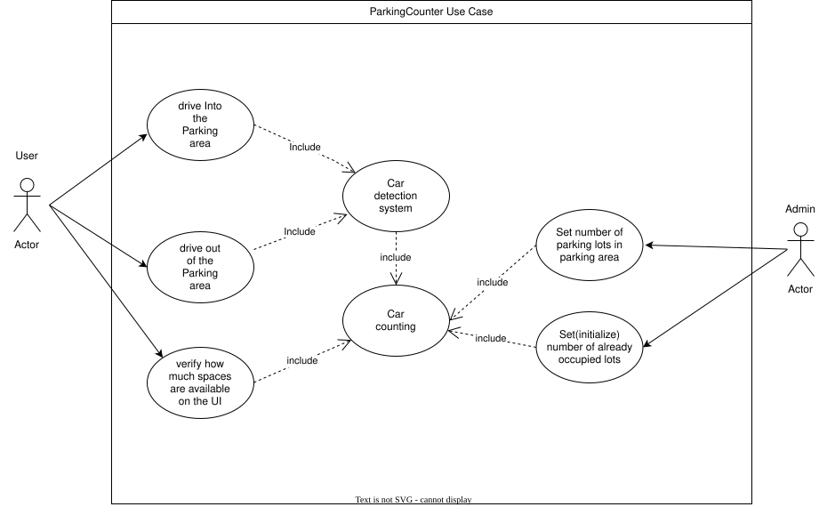

# Project Documentation: ParkingCounter

## 1. Introduction, Objectives, Constraints
### 1.1 Introduction
ParkingCounter is a program that uses a webcam to monitor the entrance of a parking area. It detects vehicles entering and leaving the parking area, keeps track of occupied and available spaces and displays the current number of available parking lots through an interface.

### 1.2 Objectives
The main goal is to create a working prototype (MVP) that:
-   Monitors the entrance of a parking area using a **webcam**.
-   Detects vehicles entering and leaving the parking area in real time.
-   Counts the number of occupied and free parking spaces across the entire parking Area.
-   Displays the current number of available parking spaces via a **User Interface**.
-   Provides data for later evaluation.

| Basisanforderung | Leistungsanforderungen | Begeisterungsanforderungen |
| --- | --- | --- |
| User interface (clear, readable, real-time display) | Car park statistics (occupancy rate by the hour, 24/7 statistics) | Intelligent detection (vehicle type) |
| Count the number of parking spaces available (automatic update, error-proofing) | System performance (update <1s, low error rate) | User guidance (available car parks, mobile app) |
| Camera detection (input/output, reliability) | | Optimisation (predictions, alerts) |

### 1.3 MVP (Minimum Viable Product)
-   **Control unit:** A computer that can run Python
-   **Sensors:** A Webcam
-   **Output:** User Interface
-   **Software:** Python script using an image detection library.

### 1.4 Constraints
-   Programming language: **Python**.
-   Version control: **GitHub**.
-   Development model: **Scrum** (3 sprints).

---

## 2. Build Instructions
To set up the project locally, follow these steps:
1.  **Clone the repository:** `git clone [https://github.com/username/parkfeld-detektor.git](https://github.com/username/parkfeld-detektor.git)`
2.  **Create a virtual environment:** `python -m venv venv`
3.  **Install dependencies:** `pip install -r requirements.txt`
4.  **Start the application:** `python main.py`

---

## 3. Brief User Guide
1.  Start the Program.
2.  Open the User Interface.
3.  Point your webcam at the entrance to the parking lot.

---

## 4. Release Plan with Expansion Stages
-   **Release 0.1 (Sprint 0):**
    - Hardware setup,
    - Project structure on GitHub,
    - HelloWorld,
    - Clean Management setup (requirements, priorities, timeline).

-   **Release 0.2 (Sprint 1 - MVP):**
    - Building the Project base (interfaces),
    - Starting the construction of the backend of the User Interface,
    - Building a Counter,
    - Developing a car recognition system that can tell if a car is going in or out of the parking lot.
    
-   **Release 1.0 (Sprint 2):**
    - Develop the CSS code for the UI,
    - New feature: Stats on the occupation of the parking lot,
    - Testing the software.

---

## 5. User Stories (Product Backlog)
Requirements are described in the form of user stories with acceptance criteria, estimated effort, and priority:

| ID | User Story | Acceptance Criterion | Effort (SP) | Priority |
| :--- | :--- | :--- | :--- | :--- |
| **US0** | As a product owner, I want to set up the project initially (GitHub repository, Jira project, release plan, Hello World), so the team can start development efficiently. | Repository and Jira project are created, all team members have access, the repository is cloned locally, and a “Hello World” runs on every computer. | 5 | Highest |
| **US1** | As a Product Owner, I want to set requirements, to plan the project. | Clear requirements are defined, documented, and prioritized in the backlog. | 3 | High |
| **US2** | As a Scrum Master, I want to set priorities for the project to work well. | User stories are prioritized and distributed clearly across the 3 sprints. | 3 | Medium |
| **US3** | As a Scrum Master, I want to do a clear timeline, to have an organized project. | Timeline, milestones, and sprint deadlines are defined and visible to the team. | 3 | Medium |
| **US4** | As a coder, I want to connect the counter to the car recognition system, for it to be able to count with a digital camera and other systems. | Signal output from the recognition system increments/decrements the counter accurately. | 5 | High |
| **US5** | As a User, I want to have a working and accessible UI everywhere and on Phone or PC, that is able to show me in real time if a parking space is free. | The UI displays real-time available space updates across test devices. | 5 | Highest |
| **US6** | As a coder, I want to have a working car recognition system, that can detect if a car goes into the parking lot or goes out. | A functional vision-based detection model is identified and tested for direction tracking. | 8 | Highest |
| **US7** | As a coder, I want to build a working counter, that can count how many cars go in and out the parking lot so that it can be sent to the UI. | The counter updates space counts dynamically and exposes an interface for UI consumption. | 8 | Highest |
| **US8** | As a coder, I want to have a clean documentation for the project to be legible and simple to modify. | Code functions are commented inline and README documentation is complete. | 3 | High |
| **US9** | As a User, I want to be able to trust the recognition program, so that the counter can be trusted. | Detection error rate is quantified and kept within acceptable bounds (<10% error). | 5 | Medium |
| **US10** | As a User, I want to have additional data on the parking situation in the parking lot (stats). | Historical occupancy trends/stats are recorded and rendered visually. | 5 | Medium |

---

## 6. Sprint 0 Documentation (Preparation & Setup)
Sprint 0 focused on creating the organizational and technical foundation for developing the parking space occupancy detector as well as establishing **Clean Management** (requirements, priorities, and project timeline). also Building a Jira space and setting Up the github repository.

### 6.1 User Stories & Task Lists

**User Story US0:** *"As a product owner, I want to set up the project initially (GitHub repository, Jira project, release plan, Hello World), so the team can start development efficiently."*

| Task-ID | Description | Effort (h) |
| :--- | :--- | :--- |
| Task 0.1 | Create the Jira Project for backlog management and sprint control. | 2.0 |
| Task 0.2 | Create the GitHub Repository and invite collaborators. | 1.5 |
| Task 0.3 | Save/clone the GitHub Repository on each PC. | 2.0 |
| Task 0.4 | Execute "Hello World" script on each PC to verify local development setup. | 1.5 |
| Task 0.5 | Create the first release plan (timeline and expansion stages). | 1.5 |
| Task 0.6 | Documentation: create initial chapters in README.md. | 2.5 |

**User Story US1:** *"As a Product Owner, I want to set requirements, to plan the project."*

| Task-ID | Description | Effort (h) |
| :--- | :--- | :--- |
| Task 0.7 | Find the requirements for the project. | 2.5 |
| Task 0.8 | Arrange the requirements, set the priorities for each one. | 2.0 |

**User Story US2:** *"As a Scrum Master, I want to set priorities for the project to work well."*

| Task-ID | Description | Effort (h) |
| :--- | :--- | :--- |
| Task 0.9 | Set priorities for each User Story, arrange it in the 3 Sprints. | 2.0 |

**User Story US3:** *"As a Scrum Master, I want to do a clear timeline, to have an organized project."*

| Task-ID | Description | Effort (h) |
| :--- | :--- | :--- |
| Task 0.10 | Set the timeline and deadlines for each of the Stories and tasks and organize them in the sprint. | 2.5 |

### Results of Sprint 0
-   **Release plan:** Creation of an initial timeline and definition of the expansion stages.
-   **Documentation foundation:** The Documentation is created on Github as readme.md and initial structure is added to fill out later.
-   **Technical framework:** Decision which image recognition library to use.
-   **Documentation:** Fill the first chapters in Readme.md.

---

## 7. Sprint 1 Core Development (MVP Implementation)
In this sprint, a working UI, Counter, Recognition system was coded. they were also connected together. 

### 7.1 User Stories & Task Lists (Estimation in Hours)

**User Story US4:** *"As a coder, I want to connect the counter to the car recognition system, for it to be able to count with a digital camera and other systems."*

| Task-ID | Description | Effort (h) |
| :--- | :--- | :--- |
| Task 1.1 | Build an output from the recognition system to the counter. | 1.0 |
| Task 1.2 | Create a Main program that runs the sensor and the UI and the counter and gives the values to the counter and the UI. | 1.0 |
| Task 1.3 | Add interfaces (superclasses) for the sensor (camera) and the UI to set standards so they are exchangeable and communication between Main and the components works well. | 1.0 |
| Task 1.4 | Build dummy testscripts for Sensor and UI to test the Main Program alone and adapt Main if necessary. | 1.0 |
| Task 1.5 | Test Main script together with actual camera and UI. | 1.0 |

**User Story US5:** *"As a User, I want to have a working and accessible UI everywhere and on Phone or PC, that is able to show me in real time if a parking space is free."*

| Task-ID | Description | Effort (h) |
| :--- | :--- | :--- |
| Task 1.6 | Create the input interface from the counter to the UI. | 2.0 |
| Task 1.7 | Build the UI base. | 2.5 |
| Task 1.8 | Analyse the input from the counter to update the amount of free parking spaces. | 1.0 |

**User Story US6:** *"As a coder, I want to have a working car recognition system, that can detect if a car goes into the parking lot or goes out."*

| Task-ID | Description | Effort (h) |
| :--- | :--- | :--- |
| Task 1.9 | Build the car recognition system. | 4.0 |
| Task 1.10 | Test the recognition system alone, to see how it works. | 1.0 |
| Task 1.11 | Create the Output to the Counter. | 1.0 |

**User Story US7:** *"As a coder, I want to build a working counter, that can count how many cars go in and out the parking lot so that it can be sent to the UI."*

| Task-ID | Description | Effort (h) |
| :--- | :--- | :--- |
| Task 1.12 | Analyse the input signal from the recognition system to the counter, to either add one free parking space or delete one. | 4.0 |
| Task 1.13 | Create the input interface from the counter to the UI. | 2.0 |
| Task 1.14 | Build the central system that connects the counter to everything with a class. | 3.0 |

---

### 7.2 Key Code Snippets
```python
# Counter core class updating free space counts dynamically
class ParkingCounter:
    def __init__(self, capacity: int):
        self.capacity = capacity
        self.occupied = 0

    def register_entry(self):
        if self.occupied < self.capacity:
            self.occupied += 1

    def register_exit(self):
        if self.occupied > 0:
            self.occupied -= 1

    @property
    def free_spaces(self) -> int:
        return self.capacity - self.occupied

```
### 7.2 UML Diagrams
- **Use Case Diagram:** Shows how the different components work together.
  
  **Class Diagram:** Shows the `ParkingCounter` and related classes.
- **Sequence Diagram:** Visualizes the event loop between sensor/camera, counter, and UI.
---      

### Results of Sprint 1 
*   **Creation of the UI:** a simple UI Built, and connected to the counter,that can be openned on PC and Phone.
*   **Working car Recognition System:** The recognition System has been coded and works.
*   **Counter:** the counter works, it can either add or delete a Parking Space.
*   **Interconnection:** every part of the Programme is connected together. 