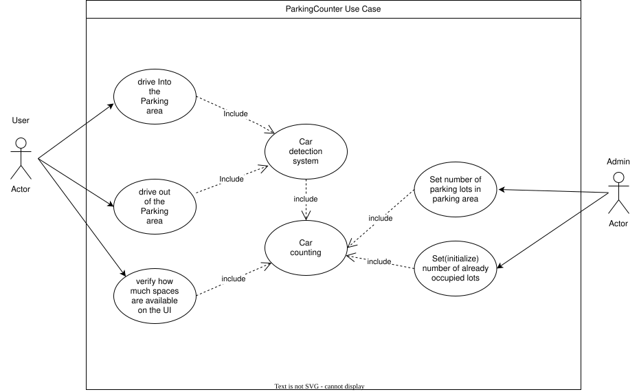
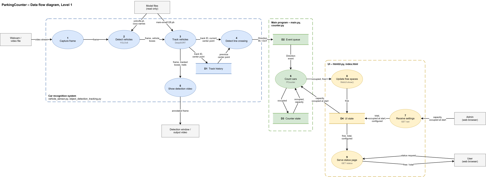
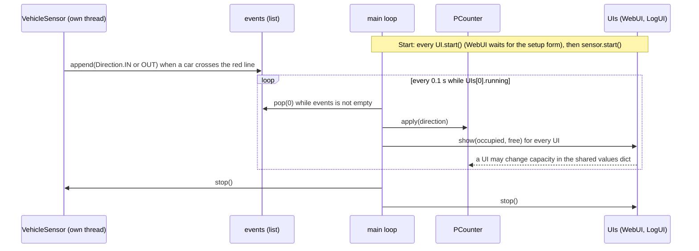
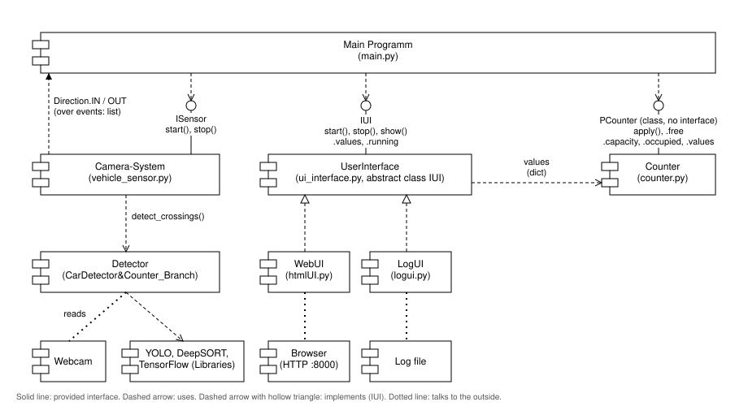
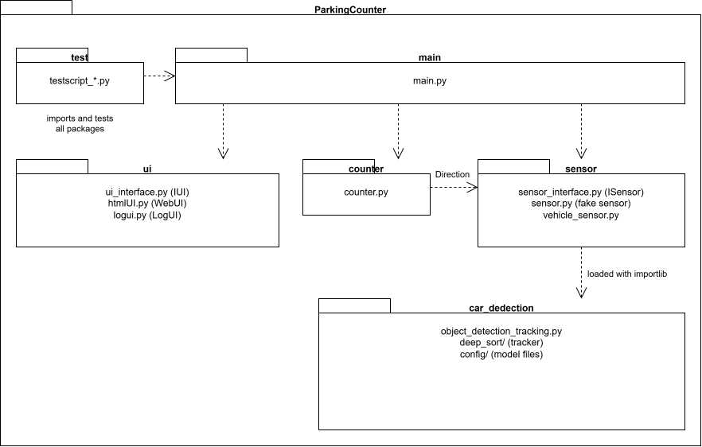
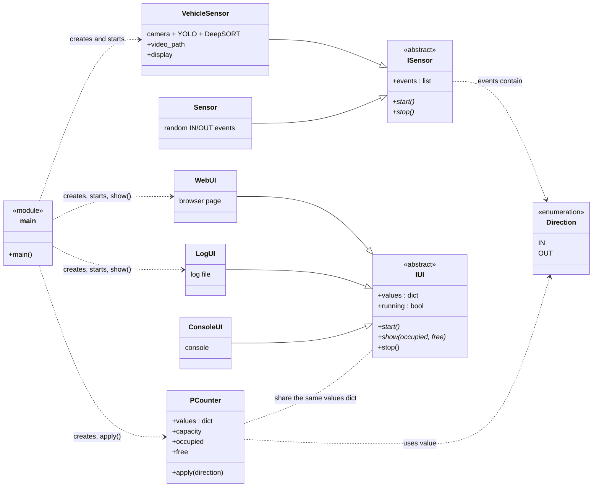

# Project Documentation: ParkingCounter

## 1. Introduction, Objectives, Constraints
### 1.1 Introduction
ParkingCounter is a program that uses a webcam to monitor the entrance of a parking area. It detects vehicles entering and leaving the parking area, keeps track of occupied and available spaces and displays the current number of available parking lots through an interface. The System is developed for the specific Parking Area above the DHBW-Lörrach and is designed as the Camera would be mounted on the roof of building D facing the street that enters the Parking Area. The Programm could be used for other similar situations too, however when the camera is installed on the other side of the street or the Parking Area is on the other side, the code must be changed accordingly so the programm knows in which direction cars are entering or exiting the Area. As we assume a fix installed installation we did not implement a setting to change the direction.

### 1.2 Objectives
The main goal is to create a working prototype (MVP) that:
-   Monitors the entrance of a parking area using a **webcam**.
-   Detects vehicles entering and leaving the parking area in real time.
-   Counts the number of occupied and free parking spaces across the entire parking Area.
-   Displays the current number of available parking spaces via a **User Interface**.
-   Provides data for later evaluation.

| Basic Requirements | Performance Requirements | Enthusiastic Requirements |
| --- | --- | --- |
| User interface (clear, readable, real-time display) | Car park statistics (occupancy rate by the hour, 24/7 statistics) | Intelligent detection (vehicle type) |
| Count the number of parking spaces available (automatic update, error-proofing) | System performance (update <1s, low error rate) | User guidance (available car parks, mobile app) |
| Camera detection (input/output, reliability) | | Optimisation (predictions, alerts) |

### 1.3 MVP (Minimum Viable Product)

**Functional scope (what the MVP can do)**
-   Detect with a webcam when a car enters or leaves the parking lot.
-   Count the cars and calculate the free parking spaces automatically.
-   Show the number of free spaces in a user interface in real time.

The Product must fulfill as a minimum the Basic Requirements (see 1.2).

### 1.4 Constraints
-   Programming language: **Python**.
-   Version control: **GitHub**.
-   Development model: **Scrum** (3 sprints).

---

## 2. Technical setup
-   **Control unit:** A computer that can run Python
-   **Sensors:** A Webcam
-   **Output:** User Interface
-   **Software:** Python script using an image detection library.

## 2.1 How to Install the Camera
Where to install the webcam ? 



## 2.2 Build Instructions
To set up the project locally, follow these steps:
1.  **Clone the repository:** `git clone https://github.com/florinbucherer/parkingcounter`
2.  **Create a virtual environment:** `python -m venv venv`
3.  **Install dependencies:** `pip install -r requirements.txt`
4.  **Follow the User Guide** (see chapter 3)


---

## 3. Brief User Guide
1.  Start the program with `python main.py`. The browser opens the setup page automatically (`http://localhost:8000`).
2.  Enter the number of parking lots and the number of already occupied parking lots at the start and press **Start**. The setup can only be sent once per program start.
3.  **Wait until the window "Vehicle Detection" with the camera picture appears.** The program first has to load the detection model and TensorFlow (see 2.1), this takes a while **During this time no cars are counted.**
4.  **Position the camera on the correct side of the road and point it towards the street. For the Parking Area of DHBW Lörrach mount it on the roof of Building D facing the street.** Align it with the help of the camera window:
    - The **red line** must lie across the road, so that every car that drives in or out crosses it. A car is counted when the centre of its frame crosses the line inside the red part.
    - Cars that **enter** the parking area must cross the line from **right to left** in the picture, cars that **leave** from **left to right**. If your camera sees it the other way round, IN and OUT must be swapped in the code (the direction is fixed in the code, `_crossing_direction` in `vehicle_sensor.py`).
    - Check that passing cars get a coloured frame with a green track.
5.  **Minimize the camera window.** The detection continues in the background.
6.  The free parking lots are shown on the web page. It opens on the host computer. To open it from another device, type the IP address of the host computer followed by `:8000` into the Browser.Please be aware of the network note below.
7.  To end the program press the **Exit** button on the web page (or `Ctrl+C` in the console).
8.  **Enjoy :)**

> **Careful in the camera window:** the key `q` stops the detection (the web page stays open, but **nothing is counted any more**). The key `p` pauses the detection until `p` is pressed again.
> **Network note:** When used with other devices in the same network everybody in the network can also press **Exit**, so only allow trusthworty devices in the network.


### 3.1 Warnings in the Console (TensorFlow)
When the program starts, the console fills with many warnings and info messages, for example about deprecated functions, about CPU instructions or about a missing graphics card (GPU / CUDA). They are printed by **TensorFlow**, which loads the appearance model of the tracker (`config/mars-small128.pb`), and **not** by our code. **They can be ignored** as long as the camera window "Vehicle Detection" appears (see chapter 3).

An error would be something different: a message with `Traceback` and a text like `Could not open video source` means that the camera does not work. The web page then keeps running, but no cars are counted.
---

## 4. Release Plan with Expansion Stages
-   **Sprint 0:**
    - Hardware setup,
    - Project structure on GitHub,
    - HelloWorld,
    - Clean Management setup (requirements, priorities, timeline).

-   **Sprint 1 - MVP:**
    - Building the Project base (interfaces),
    - Starting the construction of the backend of the User Interface,
    - Building a Counter,
    - Developing a car recognition system that can tell if a car is going in or out of the parking lot.
    
-   **Release 1.0 (Sprint 2):**
    - Develop the CSS code for the UI,
    - Testing the software.

## 4.1 Possible extensions of the project 
    
- Connect multiple Parkingcounter together and connect them all the a The UI to have a complete view of the parking situation in a city, for exemple in the DHBW beeing able to see where it is possible to parc (P1,P2 or P3)
    
- Code a Phone App for the Parkingcounter
    
- extend the recognition system for it to be able to analyse what type of vehicle is comming in the parking lot (car, truck, delivery truck, scooter, motobike, bike etc...)
    
- adding a Licence plate reader, it could be used to monetize every parking lot without the need to install gates. 

---

## 5. User Stories (Product Backlog)
Requirements are described in the form of user stories with acceptance criteria, estimated effort, and priority:

| ID | User Story | Acceptance Criterion | Effort (SP) | Priority |
| :--- | :--- | :--- | :--- | :--- |
| **US0** | As a product owner, I want to set up the project initially (GitHub repository, Jira project, release plan, Hello World), so the team can start development efficiently. | Repository and Jira project are created, all team members have access, the repository is cloned locally, and a “Hello World” runs on every computer. | 5 | Highest |
| **US1** | As a Product Owner, I want to set requirements, to plan the project. | Clear requirements are defined, documented, and prioritized in the backlog. | 3 | High |
| **US2** | As a Scrum Master, I want to set priorities for the project to work well. | User stories are prioritized and distributed clearly across the 3 sprints. | 3 | Medium |
| **US3** | As a Scrum Master, I want to do a clear timeline, to have an organized project. | Timeline, milestones, and sprint deadlines are defined and visible to the team. | 3 | Medium |
| **US4** | As a coder, I want to connect the counter to the car recognition system, for it to be able to count with a digital camera and other systems. | Signal output from the recognition system increments/decrements the counter accurately. | 5 | High |
| **US5** | As a User, I want to have a working and accessible UI everywhere and on Phone or PC, that is able to show me in real time if a parking space is free. | The UI displays real-time available space updates across test devices. | 5 | Highest |
| **US6** | As a coder, I want to have a working car recognition system, that can detect if a car goes into the parking lot or goes out. | A functional vision-based detection model is identified and tested for direction tracking. | 8 | Highest |
| **US7** | As a coder, I want to build a working counter, that can count how many cars go in and out the parking lot so that it can be sent to the UI. | The counter updates space counts dynamically and exposes an interface for UI consumption. | 8 | Highest |
| **US8** | As a coder, I want to have a clean documentation for the project to be legible and simple to modify. | Code functions are commented inline and README documentation is complete. | 3 | High |
| **US9** | As a User, I want to be able to trust the recognition program, so that the counter can be trusted. | Detection error rate is quantified and kept within acceptable bounds (<10% error). | 5 | Medium |
| **US10** | As a User, I want to have additional data on the parking situation in the parking lot (stats). | Historical occupancy trends/stats are recorded and rendered visually. | 5 | Medium |
| **US11** | As a User, I want to have a good looking and simple interface, to save some time. | The UI has a clear design and the free parking spaces are easy to read at a glance. | TBD | Low |
| **US12** | As a coder, I want to build an easy to modify UI, so that I can adapt it to every device and every use. | The UI works on phone and PC and can be changed without rewriting the program. | 7 | High |
| **US13** | As a coder, I want to adapt the recognition system for it to work with our program. | The vehicle sensor runs the detection in its own thread and sends the IN/OUT events to the counter, with a video file or a webcam. | 9 | High |

---

## 6. Sprint 0 Documentation (Preparation & Setup)
Sprint 0 focused on creating the organizational and technical foundation for developing the parking space occupancy detector as well as establishing **Clean Management** (requirements, priorities, and project timeline). also Building a Jira space and setting Up the github repository.

### 6.1 User Stories & Task Lists

**User Story US0:** *"As a product owner, I want to set up the project initially (GitHub repository, Jira project, release plan, Hello World), so the team can start development efficiently."*

| Task-ID | Description | Effort (h) |
| :--- | :--- | :--- |
| Task 0.1 | Create the Jira Project for backlog management and sprint control. | 2.0 |
| Task 0.2 | Create the GitHub Repository and invite collaborators. | 1.5 |
| Task 0.3 | Save/clone the GitHub Repository on each PC. | 2.0 |
| Task 0.4 | Execute "Hello World" script on each PC to verify local development setup. | 1.5 |
| Task 0.5 | Create the first release plan (timeline and expansion stages). | 1.5 |
| Task 0.6 | Documentation: create initial chapters in README.md. | 2.5 |

**User Story US1:** *"As a Product Owner, I want to set requirements, to plan the project."*

| Task-ID | Description | Effort (h) |
| :--- | :--- | :--- |
| Task 0.7 | Find the requirements for the project. | 2.5 |
| Task 0.8 | Arrange the requirements, set the priorities for each one. | 2.0 |

**User Story US2:** *"As a Scrum Master, I want to set priorities for the project to work well."*

| Task-ID | Description | Effort (h) |
| :--- | :--- | :--- |
| Task 0.9 | Set priorities for each User Story, arrange it in the 3 Sprints. | 2.0 |

**User Story US3:** *"As a Scrum Master, I want to do a clear timeline, to have an organized project."*

| Task-ID | Description | Effort (h) |
| :--- | :--- | :--- |
| Task 0.10 | Set the timeline and deadlines for each of the Stories and tasks and organize them in the sprint. | 2.5 |

### Results of Sprint 0
-   **Release plan:** Creation of an initial timeline and definition of the expansion stages.
-   **Documentation foundation:** The Documentation is created on Github as readme.md and initial structure is added to fill out later.
-   **Technical framework:** Decision which image recognition library to use.
-   **Documentation:** Fill the first chapters in Readme.md.

---

## 7. Sprint 1 Core Development (MVP Implementation)
In this sprint, a working UI, Counter, Recognition system was coded. they were also connected together. 

### 7.1 User Stories & Task Lists (Estimation in Hours)

**User Story US4:** *"As a coder, I want to connect the counter to the car recognition system, for it to be able to count with a digital camera and other systems."*

| Task-ID | Description | Effort (h) |
| :--- | :--- | :--- |
| Task 1.1 | Build an output from the recognition system to the counter. | 1.0 |
| Task 1.2 | Create a Main program that runs the sensor and the UI and the counter and gives the values to the counter and the UI. | 1.0 |
| Task 1.3 | Add interfaces (superclasses) for the sensor (camera) and the UI to set standards so they are exchangeable and communication between Main and the components works well. | 1.0 |
| Task 1.4 | Build dummy testscripts for Sensor and UI to test the Main Program alone and adapt Main if necessary. | 1.0 |
| Task 1.5 | Test Main script together with actual camera and UI. | 1.0 |

**User Story US5:** *"As a User, I want to have a working and accessible UI everywhere and on Phone or PC, that is able to show me in real time if a parking space is free."*

| Task-ID | Description | Effort (h) |
| :--- | :--- | :--- |
| Task 1.6 | Create the input interface from the counter to the UI. | 2.0 |
| Task 1.7 | Build the UI base. | 2.5 |
| Task 1.8 | Analyse the input from the counter to update the amount of free parking spaces. | 1.0 |

**User Story US6:** *"As a coder, I want to have a working car recognition system, that can detect if a car goes into the parking lot or goes out."*

| Task-ID | Description | Effort (h) |
| :--- | :--- | :--- |
| Task 1.9 | Build the car recognition system. | 4.0 |
| Task 1.10 | Test the recognition system alone, to see how it works. | 1.0 |
| Task 1.11 | Create the Output to the Counter. | 1.0 |

**User Story US7:** *"As a coder, I want to build a working counter, that can count how many cars go in and out the parking lot so that it can be sent to the UI."*

| Task-ID | Description | Effort (h) |
| :--- | :--- | :--- |
| Task 1.12 | Analyse the input signal from the recognition system to the counter, to either add one free parking space or delete one. | 4.0 |
| Task 1.13 | Create the input interface from the counter to the UI. | 2.0 |
| Task 1.14 | Build the central system that connects the counter to everything with a class. | 3.0 |

---
### 7.4 Test Cases Derived from the Acceptance Criteria (Sprint 1)

| ID | Acceptance criterion | Test case | Expected result | Test | Status |
| :--- | :--- | :--- | :--- | :--- | :--- |
| TC-4.1 | **US4:** the output of the recognition system increments/decrements the counter accurately | Capacity 10, 2 occupied at the start. The sensor delivers IN, IN, OUT. | 3 occupied, 7 free | unit: `test_events_are_counted` (main) | OK |
| TC-4.2 | US4 | The fake sensor runs one round. | exactly one event (IN or OUT) is in the list | unit: `test_loop_adds_one_event` | OK |
| TC-4.3 | US4 | A real car drives in across the red line (right to left). | occupied +1, free -1 | manual | open |
| TC-5.1 | **US5:** the UI shows the free spaces in real time | Open `http://localhost:8000`. | the settings page appears | unit: `test_main_page` | OK |
| TC-5.2 | US5 | Ask `/status` before the settings are sent. | empty answer (page stays on the setup form) | unit: `test_status_empty_before_settings` | OK |
| TC-5.3 | US5 | Send `/set/50/10`, then ask `/status`. | `40 / 50` | unit: `test_status_after_settings` | OK |
| TC-5.4 | US5 | The free number changes to 12. | `/status` answers `12 / 50` | unit: `test_status_follows_free_number` | OK |
| TC-5.5 | US5 | A car passes. Watch the page on a PC and on a phone. | both show the new number after about 1 s | manual | open |
| TC-6.1 | **US6:** the recognition system detects the direction | A car moves from left to right through the line. | OUT | unit: `test_touching_the_line_from_left_is_exit` | OK |
| TC-6.2 | US6 | A car moves from right to left through the line. | IN | unit: `test_touching_the_line_from_right_is_entry` | OK |
| TC-6.3 | US6 | A car starts on the line and moves away. | not counted again | unit: `test_leaving_the_line_to_the_right_is_ignored` | OK |
| TC-6.4 | US6 | A car crosses the x position of the line, but below the end of the line. | not counted | unit: `test_crossing_below_the_line_is_ignored` | OK |
| TC-6.5 | US6 | A car crosses diagonally. | the crossing point on the line decides | unit: `test_diagonal_crossing_uses_crossing_point` | OK |
| TC-6.6 | US6 | A test video with a known number of cars is counted. | the numbers of IN and OUT match | manual | open |
| TC-7.1 | **US7:** the counter updates the numbers and offers them to the UI | Capacity 10, nobody inside. | 10 free | unit: `test_empty_lot` | OK |
| TC-7.2 | US7 | One car in. | 9 free | unit: `test_one_car_in` | OK |
| TC-7.3 | US7 | One car out (1 was inside). | 10 free | unit: `test_one_car_out` | OK |
| TC-7.4 | US7 | Capacity 2, two cars in. | 0 free | unit: `test_lot_full` | OK |
| TC-7.5 | US7 | Capacity 2, three cars in. | 0 free (never below 0) | unit: `test_extra_car_stays_full` | OK |
| TC-7.6 | US7 | A car goes out of an empty lot (capacity 3). | still 3 free, never a negative count | unit: `test_car_out_of_empty_lot` | OK |
| TC-7.7 | US7 | Capacity 10 with 4 inside, the capacity changes to 20. | 16 free | unit: `test_change_capacity` | OK |
| TC-7.8 | US7 | A UI changes `values` and another UI reads it. | all UIs see the same numbers | unit: `test_counter_values_are_given_to_every_ui`, `test_change_in_dictionary_reaches_counter` | OK |
---      

### Results of Sprint 1 
*   **Creation of the UI:** a simple UI Built, and connected to the counter,that can be openned on PC and Phone.
*   **Working car Recognition System:** The recognition System has been coded and works.
*   **Counter:** the counter works, it can either add or delete a Parking Space.
*   **Interconnection:** every part of the Programme is connected together. 


---

## 8. Sprint 2 Expansion (Adaptation, Log, UI Design & Testing)
In this sprint, the recognition system was adapted to our program (own thread, webcam), the UI got an exit button, every change of the parking lot is written to a log file and the code is covered by unit tests. The UI design, the stats display, the error rate and the last parts of the documentation are still open (marked with *open*).

### 8.1 User Stories & Task Lists (Estimation in Hours)

**User Story US8:** *"As a coder, I want to have a clean documentation for the project to be legible and simple to modify."*

| Task-ID | Description | Effort (h) |
| :--- | :--- | :--- |
| Task 2.1 | Document each function of the code directly inside of it. | 2 |
| Task 2.2 | Write in the GitHub the important lines of code and explain how they work (see 8.2). | 0.5 |
| Task 2.3 | Finish the README: from which side the camera must be pointed, how long to wait until the program works at startup, explanation of abstraction, why lists instead of queues, why abstract classes instead of interfaces, why the program is kept simple.  | 2 |

**User Story US9:** *"As a User, I want to be able to trust the recognition program, so that the counter can be trusted."*

| Task-ID | Description | Effort (h) |
| :--- | :--- | :--- |
| Task 2.4 | Write unit tests for the counter, the sensors, the UIs and the main program. | 3.5 |
| Task 2.5 | Test the counter in combination with the recognition system (real video or camera).  | 0.5 |
| Task 2.6 | Set a percentage of errors.  | 0.5 |
| Task 2.7 | Analyse the errors and see how we could reduce them.  | 0.5 |

**User Story US10:** *"As a User, I want to have additional data on the parking situation in the parking lot (stats)."*

| Task-ID | Description | Effort (h) |
| :--- | :--- | :--- |
| Task 2.8 | Add a clock to the car counting system: every change gets a time stamp in a log file (time, event, free and occupied lots). | 2 |
| Task 2.9 | Implement a system to show the stats of how many cars are usually on the parking lot at a given time/date. *(open)* | TBD |
| Task 2.10 | Integrate it with the UI. *(open)* | 1 |

**User Story US11:** *"As a User, I want to have a good looking and simple interface, to save some time."*

| Task-ID | Description | Effort (h) |
| :--- | :--- | :--- |
| Task 2.11 | Find or build a graphic template for the UI to look good and be easy to understand. *(optional)* | TBD |
| Task 2.12 | Write the CSS code | 1 |

**User Story US12:** *"As a coder, I want to build an easy to modify UI, so that I can adapt it to every device and every use."*

| Task-ID | Description | Effort (h) |
| :--- | :--- | :--- |
| Task 2.13 | Find a way to build a UI that can work on both phone and PC: a web page served by a small web server in the local network. | 0.5 |
| Task 2.14 | Keep the page (`index.html`) separate from the Python code, so the design can be changed without touching the program. | 0 |
| Task 2.15 | Add an exit button that ends the program and closes the page. | 0.5 |
| Task 2.16 | Check the page on different devices and adapt it if necessary. *(open)* | 0.5 |

**User Story US13:** *"As a coder, I want to adapt the recognition system for it to work with our program."*

| Task-ID | Description | Effort (h) |
| :--- | :--- | :--- |
| Task 2.17 | Think about how the recognition system can be used to count and how to set an output for it. | 1 |
| Task 2.18 | Build the output to the counter: the sensor puts IN/OUT events into the shared list that the main program reads. | 1 |
| Task 2.19 | Run the detection in its own thread, so the program does not freeze. | 2 |
| Task 2.20 | Connect the sensor to a webcam (video input 0) in addition to a video file. | 1.5 |
| Task 2.21 | Add `requirements.txt` for the camera and detection libraries. | 0.5 |

---

### 8.2 Key Code Snippets
```python
# counter.py - the counter only knows numbers, nothing about sensors or UI
class PCounter:
    def apply(self, direction: Direction):
        self.occupied = max(0, self.occupied + direction.value)   # IN = +1, OUT = -1, never below 0

    @property
    def free(self) -> int:
        return max(0, self.capacity - self.occupied)              # never below 0, even if the lot is over full
```

```python
# vehicle_sensor.py - decides if a car crossed the counting line and in which direction
@staticmethod
def _crossing_direction(previous, current, line_x=750, line_top=200, line_bottom=700):
    if current[0] == previous[0]:
        return None                                  # no sideways movement, nothing to count
    if previous[0] < line_x <= current[0]:
        direction = Direction.OUT                    # left -> right = car leaves
    elif previous[0] > line_x >= current[0]:
        direction = Direction.IN                     # right -> left = car enters
    else:
        return None                                  # the car did not cross the line

    # y position where the car path meets the line
    crossing_y = previous[1] + (
        (current[1] - previous[1]) * (line_x - previous[0])
        / (current[0] - previous[0])
    )
    # only count it if the crossing is on the real line segment
    return direction if line_top <= crossing_y <= line_bottom else None
```

```python
# logui.py - second, independent UI: writes one line to a text file for every change
def show(self, occupied, free):
    if self._last is None:
        self._log("Start", occupied, free)           # first call = start of the program
    elif occupied > self._last[0]:
        cars = occupied - self._last[0]
        self._log("Car in" if cars == 1 else f"{cars} cars in", occupied, free)
    elif occupied < self._last[0]:
        cars = self._last[0] - occupied
        self._log("Car out" if cars == 1 else f"{cars} cars out", occupied, free)
    self._last = (occupied, free)                    # remember the numbers to see the next change
```
### 8.3 Interesting Code Passages

**1. Abstraction and polymorphism: main only knows the abstract class.** Every UI has to implement `start()` and `show()`. Main does not care which UI it is, it just calls the methods (see 7.4).

```python
# ui_interface.py - every UI has to implement start() and show()
class IUI(ABC):
    def __init__(self, values: dict):
        self.values = values
        self.running = True

    @abstractmethod
    def start(self):
    # ...
    @abstractmethod
    def show(self, occupied: int, free: int):
    # ...
    def stop(self):
        """Optional: clean up. Does nothing by default."""
```

```python
# main.py - main only works with the abstract type, not with the concrete UIs
UIs = [WebUI(counter.values), LogUI(counter.values, "parkingcounter.log")]
for ui in UIs:
    ui.start()
# ...
            for ui in UIs:
                ui.show(counter.occupied, counter.free)
```

**2. The detector gets the decision as a function (callback + generator).** The detection code does not know `Direction`, the counter or the UI. The sensor gives it the function `_crossing_direction`, which decides *IN* or *OUT*. This function is a `@staticmethod` without any camera, so it can be unit tested easily (10 tests). `yield` makes `detect_crossings` a generator: the sensor receives one direction after the other while the camera loop keeps running.

```python
# vehicle_sensor.py - the sensor hands the decision "IN or OUT" to the detector
for direction in detector.detect_crossings(
    self._crossing_direction,
    self.video_path,
    output_path=self.output_path,
    stop_event=self._stop_event,
    display=self.display,
):
    self.events.append(direction)
```

```python
# object_detection_tracking.py - the detector knows nothing about Direction, counter or UI
direction = crossing_direction(
    history[-1], center, line_x, line_top, line_bottom
)
# ...
if direction is not None:
    history.clear()
    history.append(center)
    yield direction
```

#Todo - Fix this
**3. Loading the detector and lazy imports.** The detector lies in a folder whose name (`CarDetector&Counter_Branch`) is not a valid Python name, so it cannot be imported normally. `importlib` loads it from its file path. The heavy libraries (OpenCV, YOLO, TensorFlow) are imported inside the function, so they are only loaded when the detection really starts. This keeps `import vehicle_sensor` fast, and the unit tests replace the whole detector with a small fake module.

```python
# vehicle_sensor.py - load the detector from a file path
module_path = TRACKING_DIR / "object_detection_tracking.py"
spec = importlib.util.spec_from_file_location(
    "parkingcounter_object_detection_tracking", module_path
)
detector = importlib.util.module_from_spec(spec)
spec.loader.exec_module(detector)
```

```python
# object_detection_tracking.py - heavy libraries are imported when the detection starts
def detect_crossings(
    # ...
) -> Iterator[Event]:
    """Track vehicles and yield the direction returned for each line crossing."""
    import cv2
    import numpy as np
    from ultralytics import YOLO
```

**4. Threads and a stop flag.** The detection runs in its own thread, so the main loop and the UIs do not freeze. A `threading.Event` is the thread-safe stop flag: `stop()` sets it, the detector checks it for every picture (`while not stop_event.is_set()`). `daemon=True` means the thread cannot keep the program alive, and `join()` waits until the camera is released. Starting a running sensor a second time raises an error.

```python
# vehicle_sensor.py - detection in its own thread
def start(self):
    if self._thread is not None and self._thread.is_alive():
        raise RuntimeError("Vehicle sensor is already running")
    self._stop_event.clear()
    self._thread = threading.Thread(target=self._run, daemon=True)
    self._thread.start()

def stop(self):
    self._stop_event.set()
    if self._thread is not None:
        self._thread.join()
        self._thread = None
```

**5. Error handling.** There are three layers. Wrong input is stopped at the border: the web handler answers an invalid setting with HTTP 400 instead of crashing, and `ConsoleUI` asks again until the input is valid. Only the expected exceptions are caught, no bare `except`. `finally` in main.py cleans up in every case: main stops the sensor and the UIs (also after `Ctrl+C`), and the detector releases the camera, the video file and the windows. (c) Errors are raised early, e.g. `Could not open video source`.

```python
# main.py - always clean up, also when the program is ended with Ctrl+C
try:
    while UIs[0].running:
        # ...
except KeyboardInterrupt:
    pass
finally:
    sensor.stop()
    for ui in UIs:
        ui.stop()
```

```python
# htmlUI.py - validate the input from the browser
try:
    new_total = int(parts[2])
    new_occupied = int(parts[3])
except (IndexError, ValueError):
    new_total, new_occupied = 0, -1
if new_total < 1 or not 0 <= new_occupied <= new_total:
    self.send_error(400, "Invalid settings")
    return
```

```python
# object_detection_tracking.py - release the resources in every case
finally:
    if video_cap is not None:
        video_cap.release()
    if writer is not None:
        writer.release()
    if display:
        cv2.destroyAllWindows()
```

**7. Unit tests without camera and browser.** Because main only knows the abstract classes, a test can replace the sensor and the UIs by fakes. `patch` swaps the classes inside the module `main`, and the fake sensor puts two cars in and one out. `patch("main.time.sleep")` makes the loop fast. The same idea is used for the vehicle sensor (a fake detector module) and for the web handler (a real server on a free port).

```python
# testscript_main.py - main is tested without camera and browser
        # fake sensor: when started it puts two cars in and one out
        def make_sensor(events):
            sensor = MagicMock()
            sensor.start.side_effect = lambda: events.extend([Direction.IN, Direction.IN, Direction.OUT])
            return sensor

        with patch("main.WebUI", side_effect=self.ui_class(ui)), \
             patch("main.LogUI"), \
             patch("main.VehicleSensor", side_effect=make_sensor), \
             patch("main.time.sleep"):
            main.main()
        self.assertEqual(shown, [(3, 7)])   # 2 + 2 - 1 = 3 occupied
```

**8. `@property` and setter: the counter owns the numbers.** The numbers live in the dictionary `counter.values`. Main gives this one dictionary to every UI, so all UIs work on the same numbers and no UI keeps its own copy. `@property` lets the rest of the code read `counter.occupied` like a normal variable, and the setter runs whenever something is assigned (`counter.occupied = ...`). The rule "never below 0" is written in one single place, the setter, and not repeated everywhere the number is changed. This makes the rest of the code simpler and easier to read: `apply()` is a single line, and `counter.capacity = 20` is enough to change the capacity, so no extra method like `set_capacity()` is needed. Initially we had a solution where the UI's owned the occupied and free values but with the introduction of a second UI (logUI) this made confusion because there where two versions.

```python
# counter.py - the counter owns capacity and occupied in one dictionary
class PCounter:
    def __init__(self, capacity: int = 50, occupied: int = 0):
        self.values = {"capacity": capacity, "occupied": max(0, occupied)}

    @property
    def occupied(self) -> int:
        return self.values["occupied"]

    @occupied.setter
    def occupied(self, occupied: int):
        self.values["occupied"] = max(0, occupied)

    def apply(self, direction: Direction):
        self.occupied = self.occupied + direction.value
```

### 8.4 Test Cases Derived from the Acceptance Criteria (Sprint 2)
Same procedure as in 7.5. The *Status* column of the manual tests is the test protocol and has to be filled in during the manual test (OK / failed, date, tester).

| ID | Acceptance criterion | Test case | Expected result | Test | Status |
| :--- | :--- | :--- | :--- | :--- | :--- |
| TC-8.1 | **US8:** code is commented inline | Read each file: every class and public method has a comment. | comments are there | manual review | open |
| TC-8.2 | US8: README is complete | Compare the README with the structure required by the assignment (chapters 1 to 7). | every chapter is filled in | manual review | open |
| TC-9.1 | **US9:** error rate below 10 % | Run a video with a known number of cars (for example 20 in, 20 out) and compare it with the counter. | difference of 10 % or less | manual | open |
| TC-9.2 | US9 | A pedestrian or a bicycle crosses the red line. | not counted | manual | open |
| TC-9.3 | US9 | The counter is never negative and free is never below 0. | see TC-7.5 and TC-7.6 | unit | OK |
| TC-10.1 | **US10:** every change is logged | Start, one car in, one car out, press Exit. | `parkingcounter.log` contains the lines Start, Car in, Car out, Stop with time, free and occupied | manual (`LogUI` has no unit test yet) | open |
| TC-12.1 | **US12:** the UI works on phone and PC and can be changed | Open the page on a PC and on a phone (see the network note in chapter 3). | page works on both | manual | open |
| TC-12.2 | US12 | Change the colour in `index.html`, restart. | program works, new colour | manual | open |
| TC-12.3 | US12 | Press the Exit button. | the program ends and port 8000 is free again | manual | open |
| TC-12.4 | US12 | Send `/set/abc/` (invalid settings). | HTTP 400, no crash | manual (no unit test yet) | open |
| TC-12.5 | US12 | Send the settings a second time. | the second one is ignored | manual (no unit test yet) | open |
| TC-13.1 | **US13:** the vehicle sensor runs in its own thread and sends IN/OUT | `start()` starts a thread. | thread is alive | unit: `test_start_runs_a_thread` | OK |
| TC-13.2 | US13 | `stop()` ends the thread. `start()` works again afterwards. | thread ended, stop flag set. New thread is alive. | unit: `test_stop_ends_the_thread`, `test_start_again_after_stop` | OK |
| TC-13.3 | US13 | `start()` is called on a running sensor. | `RuntimeError` | unit: `test_second_start_raises_error` | OK |
| TC-13.4 | US13 | The fake detector delivers IN and OUT. | `events == [IN, OUT]`, also inside the thread | unit: `test_events_are_queued`, `test_works_inside_the_thread` | OK |
| TC-13.5 | US13 | Start with the webcam (video input 0). | the window "Vehicle Detection" appears and cars are counted | manual | open |
| TC-13.6 | US13 | Start with a video file: `VehicleSensor(events, video_path="video.mp4")` in `main.py`. | cars from the video are counted | manual | open |

**Coverage:** a rough measurement with Python's built-in `trace` module over our own modules (without the adapted detector library) gives about 90 % of the lines. `LogUI` has no unit tests yet, and the exit button, `WebUI.stop()` and the invalid-settings answer of the web handler are not tested either. A more exact value can be measured with `pip install coverage`, then `coverage run -m unittest discover -s test -p "testscript_*.py" -t .` and `coverage report`.


### Results of Sprint 2
*   **Recognition system adapted:** The vehicle sensor runs the detection in its own thread, sends the IN/OUT events to the counter and works with a video file or a webcam.
*   **UI:** The UI has an exit button that ends the program and closes the page.
*   **Log:** Every change of the parking lot is written with the time to a log file (`parkingcounter_log.txt`).
*   **Unit tests:** The counter, the sensors, the UIs and the main program are covered by unit tests (`test/` folder, the target of 70% coverage is reached).
*   **Still open:** UI design (CSS), stats display in the UI, error rate of the recognition.


---
## 9. Structure and Abstraction
### 9.1 UML Diagrams
- **Use Case Diagram:** Shows how the different components work together.


**Data Flow Diagram (Datenflussdiagramm):** 


- **Sequence Diagram:** Visualizes the event loop between sensor/camera, counter, and UI. (This is not after UML standard but just for a better understanding.)



> **UML Component Diagram** (*Komponentendiagramm*).

> **TODO - placeholder: UML Package Diagram** (*Paketdiagramm*).

**Class Diagramm** (*Klassendiagram*)


### 9.2 Architecture: Abstraction and Replaceable Parts
The program is split into a few small parts. Each part has **one job**, and **only `main.py` knows all of them**. That is why a part can be replaced without touching the others, this makes the programm very flexible. For example the camera sensor could easily be exchanged with a light barrier, all that matters is that it inherits from the ISensor superclass. The same is for the UI. Even the counter could be replaced but it would need to be structured the same way with the values dictionarry because it has no superlass. We deliberately chose to not have a superclass for the counter because its not probable that someone will want to exchange the counter, however the UI and the Sensor must be exchangeble.

| Part | Files | Abstract class | Implementations | Could be replaced by |
| :--- | :--- | :--- | :--- | :--- |
| **Sensor** (detects cars) | `sensor_interface.py`, `sensor.py`, `vehicle_sensor.py` | `ISensor` | `VehicleSensor` (webcam or video + YOLO + DeepSORT), `Sensor` (random IN/OUT events, for development without a camera) | any other sensor, e.g. induction loop, light barrier, ultrasonic sensors |
| **UI** (shows the result) | `ui_interface.py`, `htmlUI.py`, `dummy_ui.py`, `logui.py` | `IUI` | `WebUI` (browser page), `ConsoleUI` (console, also used as dummy UI during development), `LogUI` (log file) | display with LEDs, mobile app, ... |
| **Counter** (counts) | `counter.py` | none | `PCounter` | nothing (only one implementation, the logic is trivial) |
| **Main** (connects) | `main.py` | none | none | creates the parts, hands them over and runs the loop |
| **Detection library** | `CarDetector&Counter_Branch/...` | none | adapted *Real-Time Vehicle Detection, Tracking and Counting* code | hidden behind `VehicleSensor`, the rest of the program does not know it |

**Who knows whom:**
- The **sensor** only knows the `events` list and the enum `Direction`. It appends `Direction.IN` or `Direction.OUT`.
- The **counter** only knows `Direction` (`IN` = +1, `OUT` = -1).
- A **UI** only knows the `values` dictionary (`capacity`, `occupied`) that it gets when it is created, and the numbers that main passes to `show(occupied, free)`.
- **Main** connects everything: the `events` list (sensor to main), the `values` dictionary (counter and UIs share it) and `show()` (main to UIs).

**How to replace or add a part:** write a class that inherits from `ISensor` or `IUI`, implement the abstract methods and change the one line in `main.py` where the part is created. Example for a new UI:

```python
class PrintUI(IUI):                        # a new UI in three lines
    def start(self): pass
    def show(self, occupied, free): print(free)

UIs = [WebUI(counter.values), PrintUI(counter.values)]   # in main.py. UIs[0] decides when the program ends
```

**Why abstract classes and not interfaces?** A *pure* interface would only list method names. `ISensor` and `IUI` do more: they already store shared data in `__init__` (`events`, `values`, `running`) and `IUI.stop()` has a default implementation that does nothing, so its voluntarily to use and a subclass does not have to write it. Because they contain code, they are **abstract classes and not pure interfaces** (the `I` in the name only shows the role they play). They still give the same safety: a class that forgets `start()` or `show()` cannot be created at all and raises a `TypeError` (see the tests `test_interface_cannot_be_created`).
We chose this deliberately because it makes it easyer to define subclasses.

## 10. Design Decisions: What We Deliberately Kept Simple
We kept some things deliberately simple so we can understand our Programm and explain it but there would be cleaner solutions

| What is simple | Why it is simple | Cleaner solution |
| :--- | :--- | :--- |
| `events` is a plain **list** | `list.append()` and `list.pop(0)` are atomic in CPython and there is exactly one writer (sensor thread) and one reader (main), so nothing can go wrong. Everybody in the team understands a list. | `queue.Queue`
| **Polling** instead of push | The main loop sleeps 0.1 s, the web page asks `/status` every 0.5 s. No extra library, and fast enough for our case. | I know there are librarys for this|
| **Global variables** The values are shared between the Handler and the WebUI class through global Variables | The Handler could have been made inside the WebUI class, but I didn't understand how to do that. |
| **No abstract class for the counter** | One implementation and trivial logic. | Add an `ICounter` as soon as a second implementation is needed. |
| **Fixed settings in the code**: port 8000, camera `0`, position of the line (750/1280 of the width), confidence 0.3, direction | One fixed installation at one parking area (see 1.1). | Settings Menu to change camera and also setup later |
| **`LogUI` opens the file for every line** | Short lines, rare writes, no thread needed. | It would be possible to make a thread or maybe there is even a library for logging |
| **Counting errors are not corrected** | The numbers come from the camera only and are entered once at the start, we didn't have time to implement a setting menu to change the numbers later. | for example buttons to correct the number by hand. |

---

## 11. Ideas for Further Improvement
- **Show errors of the sensor thread in UI.** At the moment an error in the detection (for example no camera) only prints a `Traceback`, while the program runs on and counts nothing. `VehicleSensor._run` could catch the error, remember it, and main could show it in the UIs.
- **Key `q` in the camera window** stops only the detection and not the program. It could end the whole program, or be ignored.
- **More tests:** `LogUI`, the exit button and the invalid-settings answer of the web handler (see the coverage note in 8.4).
- **Statistics (US10):** write the log as CSV and draw the occupancy by the hour to the UI.
- **Choose the camera or a video file** with a command-line argument or even through the UI instead of editing `main.py`.
- **Explicit states** with an `Enum` (`WAITING_FOR_SETUP`, `RUNNING`, `EXITING`) instead of the two flags. This could also be shown in the UI.
- **Add an Admin to who can change settings and exit the Programm on the UI but normal user can't**
